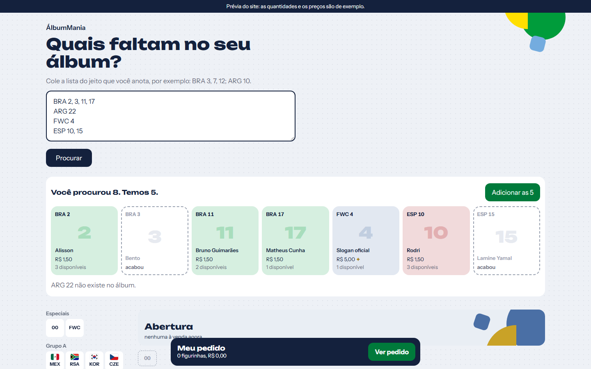
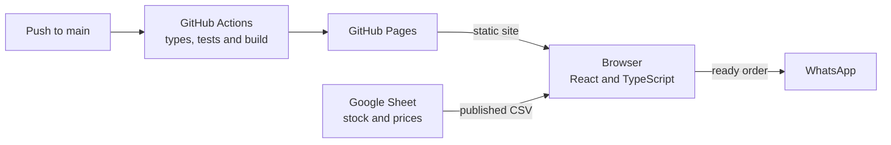

# ÁlbumMania

An online catalog of single stickers for the 2026 World Cup album. Shoppers paste the list of stickers they are missing, the site shows what is in stock, builds the order and sends it through WhatsApp. There is no back end and no database: the stock lives in a Google Sheet.

**Demo:** https://eduardofedeli.github.io/albummania/previa/ (sample quantities and prices) · [Leia em português](README.md)

<p align="center">
  
  
</p>

## What it does

- **Paste your missing list:** shoppers paste the list the way they write it down (`BRA 3, 7, 12; ARG 10`); the site shows what is and is not available and adds everything to the order at once.
- **Forgiving search:** finds `bra10`, `BRA 10` or `bra-10`, and names typed without accents.
- **A cart that survives closing the tab**, always capped at the available stock.
- **Estimated total** based on the price of each sticker type.
- **Order through WhatsApp**, with the message grouped by section, or copied to paste anywhere.

## Stack

| Layer | Technology |
|---|---|
| Interface | React 19, TypeScript, Vite |
| Data | Google Sheet published as CSV |
| Tests | Vitest |
| CI/CD and hosting | GitHub Actions and GitHub Pages |

## How it works



Three decisions behind the design:

- **The sheet is the source of truth.** The seller updates the stock in a tool they already know, and there is no server or database to maintain: running costs are zero.
- **The sheet is read straight from the browser.** The tabs published as CSV are read by the site itself. Those links are public by nature, so there is no secret to hide.
- **The rules live outside React.** Search, list parsing and the cart are plain TypeScript, tested without the interface.

On every push to `main`, GitHub Actions checks the types, runs the tests, builds the site and publishes it to GitHub Pages. The full decision records are in [`docs/adr`](docs/adr); the architecture, with flows, failure modes and risks, is in [`docs/system-design.md`](docs/system-design.md); the domain glossary is in [`CONTEXT.md`](CONTEXT.md); and the design system is in [`docs/design-system.md`](docs/design-system.md). The documentation and the interface are in Portuguese.

## Running locally

You need Node.js 24, the same version the pipeline uses.

```bash
git clone https://github.com/EduardoFedeli/albummania.git
cd albummania
cp .env.example .env
npm install
npm run dev   # http://localhost:5173/albummania/previa/
npm test
```

The `.env.example` file already points to a test sheet. In GitHub Actions, the same URLs come from repository variables.

## Author

Built by **Eduardo Fedeli** ([GitHub](https://github.com/EduardoFedeli) · [LinkedIn](https://www.linkedin.com/in/eduardofedeli)).
