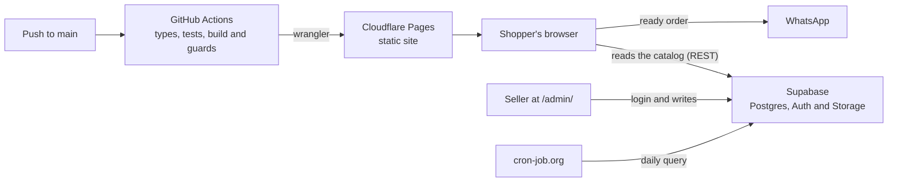

# ÁlbumMania

An online store for single stickers, trading cards and collectibles. The seller registers collections and items, with photo, price and stock, in a dashboard that requires login. Shoppers search, build an order and send it through WhatsApp, where the sale is agreed. There is no custom server, and running costs are zero.

[Leia em português](README.md)

<p align="center">
  
  
</p>

## What it does

**For shoppers:**

- **Forgiving search:** finds `HR-013` typed as `hr013` or `hr 013`, and names typed without accents.
- **Collections as filters**, and an item without a photo shows the album number in its place.
- **A cart that survives closing the tab**, capped at the stock and checked again on every visit: if an item sold out, it leaves the cart and the shopper is told.
- **Order through WhatsApp**, grouped by collection, with subtotals and an estimated total, or copied to paste anywhere.

**For the seller, at `/admin/`:**

- Email and password login.
- Free-form collections: create, rename, reorder and delete.
- Items with a photo taken on the phone, compressed in the browser before upload (from several MB down to tens of KB).
- **Quick stock updates:** − and + right in the list.

## Stack

| Layer | Technology |
|---|---|
| Interface | React 19, TypeScript, Vite |
| Database, login and photos | Supabase: Postgres with Row Level Security, Auth and Storage |
| Tests | Vitest |
| Hosting and CI/CD | Cloudflare Pages and GitHub Actions |

## How it works



Three decisions behind the design:

- **There is no custom server.** The browser talks to Supabase directly, and the database itself decides who may write, through Row Level Security. The key shipped in the JavaScript is public on purpose: reading the catalog is open, and writing requires an account listed in the administrators table.
- **The storefront stays light.** It reads the database with `fetch`, without the Supabase library, and the seller's dashboard lives on a separate page. A CI step blocks the deploy if dashboard code leaks into the storefront.
- **The rules live outside React.** Search, the cart, the order message, parsing typed prices and form validation are plain TypeScript, with tests.

On every push to `main`, GitHub Actions checks the types, runs the tests, builds the site, applies the guards and publishes to Cloudflare Pages. The decision records are in [`docs/adr`](docs/adr); the architecture in [`docs/system-design.md`](docs/system-design.md); operations (accounts, deploys and what to do when something breaks) in [`docs/operacao.md`](docs/operacao.md); the domain glossary in [`CONTEXT.md`](CONTEXT.md); and the design system in [`docs/design-system.md`](docs/design-system.md). The documentation and the interface are in Portuguese.

## Running locally

You need Node.js 24, the same version the pipeline uses, and a Supabase project (the free plan is enough).

1. In the Supabase **SQL Editor**, run [`supabase/schema.sql`](supabase/schema.sql) and, for sample data, [`supabase/exemplo.sql`](supabase/exemplo.sql).
2. Then:

```bash
git clone https://github.com/EduardoFedeli/albummania.git
cd albummania
cp .env.example .env   # fill in your project's URL and publishable key
npm install
npm run dev            # store at http://localhost:5173 and dashboard at /admin/
npm test
```

To sign in to the dashboard, create a user in Supabase and add it to the `administradores` table: the steps are in [`docs/operacao.md`](docs/operacao.md).

## History

The first version sold only stickers from the 2026 World Cup album, with the stock in a Google Sheet. It lives in the [`v1-planilha`](https://github.com/EduardoFedeli/albummania/tree/v1-planilha) tag, and the [case study](docs/estudo-de-caso.md) explains why the project changed.

## Author

Built by **Eduardo Fedeli** ([GitHub](https://github.com/EduardoFedeli) · [LinkedIn](https://www.linkedin.com/in/eduardofedeli)).
