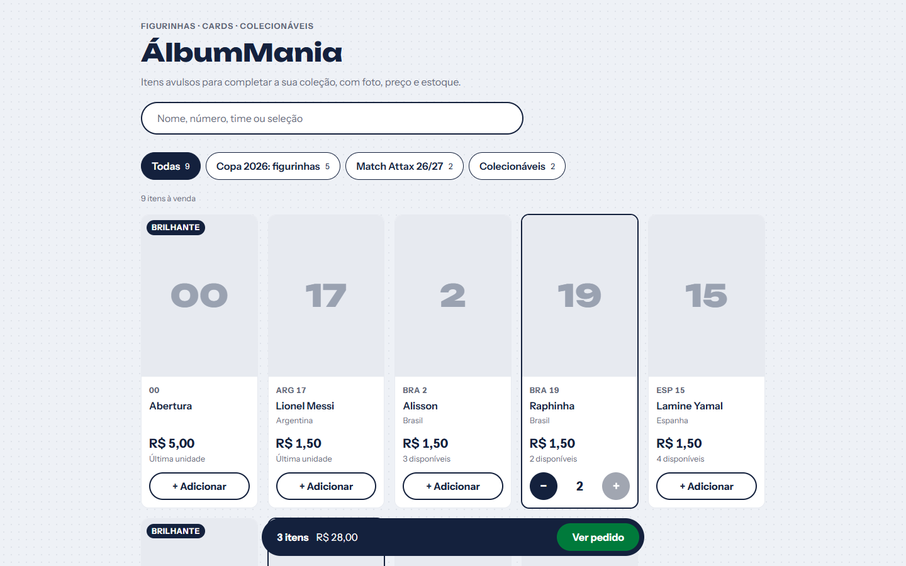
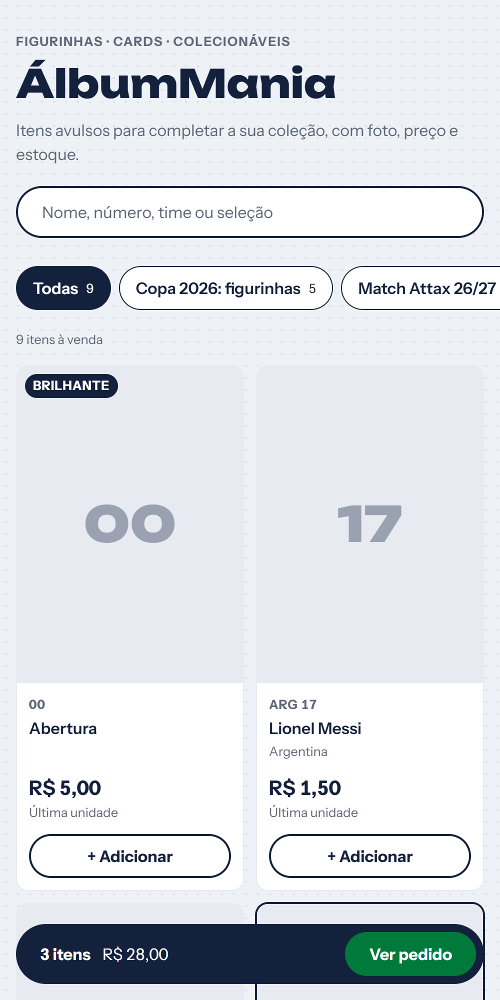
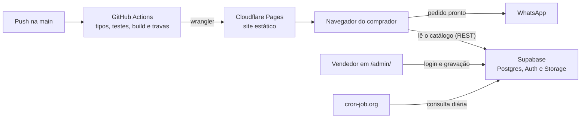

# ÁlbumMania

Loja on-line de figurinhas, cards e colecionáveis avulsos. Quem vende cadastra as coleções e os itens, com foto, preço e estoque, num painel com login. Quem compra busca, monta o pedido e envia pelo WhatsApp, onde a venda é combinada. Não há servidor próprio, e o custo mensal é zero.

[Read in English](README.en.md)

<p align="center">
  
  
</p>

## O que ele faz

**Para quem compra:**

- **Busca tolerante:** acha `HR-013` digitado como `hr013` ou `hr 013`, e nomes sem acento.
- **Coleções como filtro**, e o item sem foto aparece com o numeral do álbum no lugar.
- **Carrinho que sobrevive a fechar a aba**, limitado ao estoque e conferido de novo a cada visita: se um item acabou, ele sai e o comprador é avisado.
- **Pedido pelo WhatsApp**, agrupado por coleção, com subtotais e total estimado, ou copiado para colar onde quiser.

**Para quem vende, em `/admin/`:**

- Login com e-mail e senha.
- Coleções livres: criar, renomear, ordenar e apagar.
- Itens com foto tirada no próprio celular, comprimida no navegador antes de subir (de vários MB para dezenas de KB).
- **Baixa rápida:** − e + no estoque, direto na lista.

## Stack

| Camada | Tecnologia |
|---|---|
| Interface | React 19, TypeScript, Vite |
| Banco, login e fotos | Supabase: Postgres com Row Level Security, Auth e Storage |
| Testes | Vitest |
| Hospedagem e CI/CD | Cloudflare Pages e GitHub Actions |

## Como funciona por dentro



Três decisões que explicam o desenho:

- **Não há servidor próprio.** O navegador fala direto com o Supabase, e quem pode gravar é decidido no próprio banco, por Row Level Security. A chave que vai no JavaScript é pública de propósito: ler o catálogo é livre, e gravar exige uma conta que esteja na tabela de administradores.
- **A vitrine é leve.** Ela lê o banco com `fetch`, sem a biblioteca do Supabase, e o painel do vendedor fica numa página separada. Um passo do CI barra o deploy se o código do painel vazar para a vitrine.
- **As regras ficam fora do React.** Busca, carrinho, mensagem do pedido, leitura do preço digitado e validação do formulário são TypeScript puro, com testes.

A cada push na `main`, o GitHub Actions confere os tipos, roda os testes, faz o build, aplica as travas e publica no Cloudflare Pages. As decisões estão em [`docs/adr`](docs/adr), a arquitetura em [`docs/system-design.md`](docs/system-design.md), a operação (contas, deploy e o que fazer quando algo para) em [`docs/operacao.md`](docs/operacao.md), o glossário do domínio em [`CONTEXT.md`](CONTEXT.md) e o design system em [`docs/design-system.md`](docs/design-system.md).

## Como rodar

Você precisa do Node.js 24, a mesma versão do pipeline, e de um projeto no Supabase (o plano gratuito basta).

1. No **SQL Editor** do Supabase, rode [`supabase/schema.sql`](supabase/schema.sql) e, se quiser dados de exemplo, [`supabase/exemplo.sql`](supabase/exemplo.sql).
2. Depois:

```bash
git clone https://github.com/EduardoFedeli/albummania.git
cd albummania
cp .env.example .env   # preencha com a URL e a chave publicável do seu projeto
npm install
npm run dev            # loja em http://localhost:5173 e painel em /admin/
npm test
```

Para entrar no painel, crie um usuário no Supabase e coloque-o na tabela `administradores`: o passo a passo está em [`docs/operacao.md`](docs/operacao.md).

## História

A primeira versão vendia só figurinhas do álbum da Copa 2026, com o estoque numa planilha do Google. Ela está na tag [`v1-planilha`](https://github.com/EduardoFedeli/albummania/tree/v1-planilha), e o [estudo de caso](docs/estudo-de-caso.md) conta por que o projeto mudou.

## Autor

Desenvolvido por **Eduardo Fedeli** ([GitHub](https://github.com/EduardoFedeli) · [LinkedIn](https://www.linkedin.com/in/eduardofedeli)).
