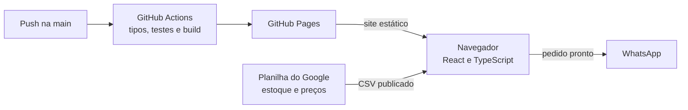

# ÁlbumMania

Catálogo online de figurinhas avulsas do álbum da Copa do Mundo 2026. Quem procura cola a lista do que falta, o site mostra o que tem, monta o pedido e envia pelo WhatsApp. Não há backend nem banco de dados: o estoque vive numa planilha do Google.

**Demonstração:** https://eduardofedeli.github.io/albummania/previa/ (quantidades e preços de exemplo) · [Read in English](README.en.md)

<p align="center">
  
  
</p>

## O que ele faz

- **Lista de faltantes colada:** a pessoa cola a lista do jeito que anota (`BRA 3, 7, 12; ARG 10`), o site mostra o que tem e o que não tem e adiciona tudo ao pedido de uma vez.
- **Busca tolerante:** encontra `bra10`, `BRA 10` ou `bra-10`, e nomes sem acento.
- **Carrinho que sobrevive ao fechar a aba**, sempre limitado ao estoque.
- **Total estimado** pelo preço de cada tipo de figurinha.
- **Pedido pelo WhatsApp**, com a mensagem agrupada por seção, ou copiada para colar onde quiser.

## Stack

| Camada | Tecnologia |
|---|---|
| Interface | React 19, TypeScript, Vite |
| Dados | Planilha do Google publicada como CSV |
| Testes | Vitest |
| CI/CD e hospedagem | GitHub Actions e GitHub Pages |

## Como funciona por dentro



Três decisões que explicam o desenho:

- **A planilha é a fonte da verdade.** Quem vende atualiza o estoque numa ferramenta que já conhece, e não há servidor nem banco de dados para manter: o custo de operação é zero.
- **A planilha é lida direto no navegador.** As abas publicadas como CSV são lidas pelo próprio site. Esses links já são públicos por natureza, então não há segredo para esconder.
- **As regras ficam fora do React.** Busca, leitura da lista e carrinho são TypeScript puro, testados sem precisar da interface.

A cada push na `main`, o GitHub Actions confere os tipos, roda os testes, faz o build e publica no GitHub Pages. As decisões completas estão em [`docs/adr`](docs/adr); a arquitetura, com os fluxos, os modos de falha e os riscos, em [`docs/system-design.md`](docs/system-design.md); o glossário do domínio em [`CONTEXT.md`](CONTEXT.md); e o design system em [`docs/design-system.md`](docs/design-system.md).

## Como rodar

Você precisa de Node.js 24, a mesma versão do pipeline.

```bash
git clone https://github.com/EduardoFedeli/albummania.git
cd albummania
cp .env.example .env
npm install
npm run dev   # http://localhost:5173/albummania/previa/
npm test
```

O `.env.example` já aponta para uma planilha de teste. No GitHub Actions, as mesmas URLs vêm das variáveis do repositório.

## Autor

Desenvolvido por **Eduardo Fedeli** ([GitHub](https://github.com/EduardoFedeli) · [LinkedIn](https://www.linkedin.com/in/eduardofedeli)).
