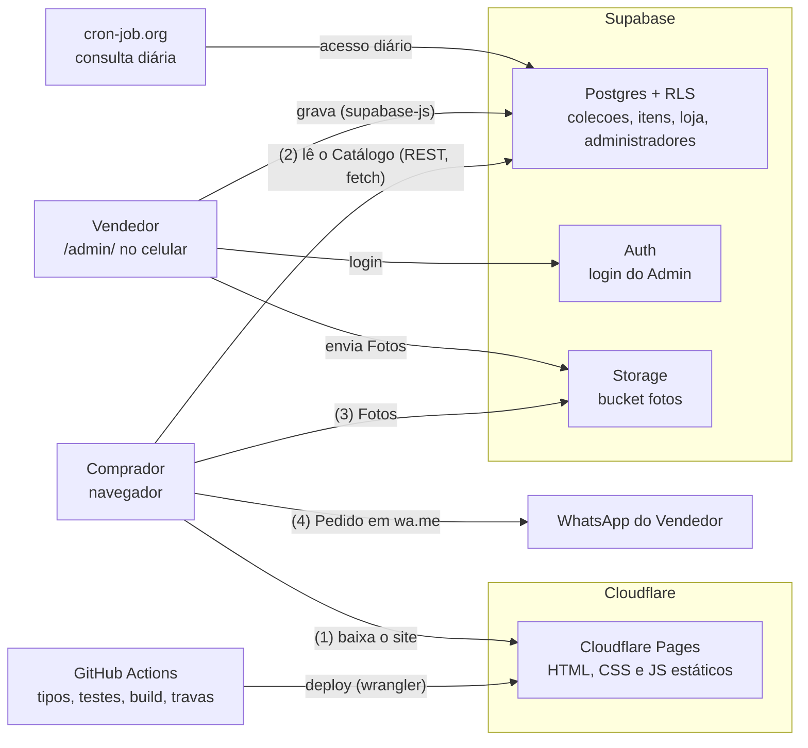
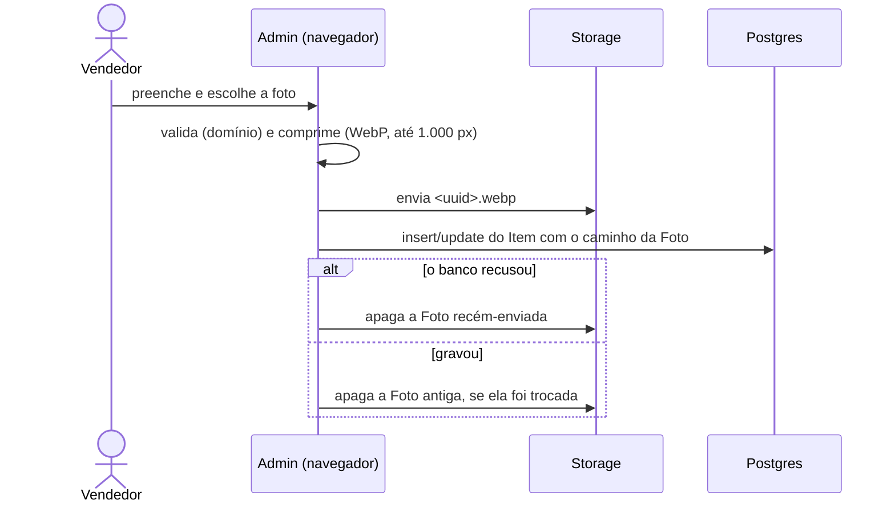

# System Design: ÁlbumMania

> **Status:** V2 · **Última revisão:** 2026-11-05
> **Leia antes:** [CONTEXT.md](../CONTEXT.md) (vocabulário) e [docs/adr/](./adr/) (decisões). Este documento mostra como as decisões se encaixam; o porquê de cada uma está nos ADRs. A V1, com a planilha, está na tag `v1-planilha`.

## 1. Contexto

Um Vendedor anuncia figurinhas, cards e colecionáveis avulsos, em Coleções que ele mesmo cria. Pelo celular, no Admin, ele cadastra os Itens com Foto e dá Baixa quando vende. O Comprador abre o link, busca, monta o Carrinho e envia o Pedido pelo WhatsApp. A Venda, com pagamento e frete, acontece na conversa, fora do sistema.

Três restrições moldam o resto:

- **Custo mensal zero** ([ADR-0005](./adr/0005-catalogo-no-supabase-com-admin.md), [ADR-0006](./adr/0006-hospedagem-no-cloudflare-pages.md)).
- **O Vendedor não mexe em banco nem em código.** O Eduardo opera o site ([operacao.md](./operacao.md)).
- **Não há servidor próprio.** O navegador fala direto com o Supabase.

## 2. Requisitos

### Funcionais

| # | O sistema deve... |
|---|---|
| RF1 | Exibir o Catálogo (Itens com Estoque > 0) na ordem das Coleções e, dentro de cada uma, pelo Código lido como número ("HR-2" antes de "HR-10"). |
| RF2 | Buscar pelo Código digitado de qualquer jeito (`HR-013`, `hr013`, `hr 013`) e por Nome, Equipe e Raridade, sem acento. |
| RF3 | Filtrar por Coleção. |
| RF4 | Manter um Carrinho limitado ao Estoque, que sobrevive a fechar a aba e é conferido com o Catálogo a cada visita, avisando o Comprador do que mudou. |
| RF5 | Montar o Pedido (agrupado por Coleção, com subtotais e total estimado), abrir o WhatsApp e oferecer "copiar mensagem" e "limpar pedido". |
| RF6 | No Admin, entrar com e-mail e senha. Só as contas da tabela `administradores` gravam. |
| RF7 | No Admin, criar, renomear, ordenar e apagar Coleções (só as vazias). |
| RF8 | No Admin, cadastrar, editar e apagar Itens, com a Foto comprimida no navegador e "Salvar e cadastrar outro". |
| RF9 | No Admin, dar Baixa com − e +, direto na lista. |
| RF10 | No Admin, editar o nome da loja e o WhatsApp que recebe os Pedidos. |

### Não funcionais

| Atributo | Meta |
|---|---|
| Custo | R$ 0 por mês: Supabase Free, Cloudflare Pages Free e cron-job.org. |
| Operação | O Vendedor muda Itens, Estoque, Preços e WhatsApp sozinho, e a mudança aparece na hora. |
| Performance | Vitrine com no máximo 100 KB de JavaScript comprimido (hoje, ~73 KB). Fotos de ~100 KB, carregadas só quando aparecem na tela. |
| Segurança | Só administradores gravam, e isso é decidido no banco (RLS). Nenhum segredo no navegador. |
| Acessibilidade | WCAG 2.1 AA ([design system](./design-system.md#critérios-de-pronto-acessibilidade)). |
| Privacidade | O site não coleta nenhum dado do Comprador: o Pedido sai pelo WhatsApp. |

### Fora do escopo

Pagamento on-line (o plano gratuito da Cloudflare também proíbe coletar dados de cartão no site), reserva de Estoque ([ADR-0002](./adr/0002-pedido-nao-reserva-estoque.md)), conta de Comprador, importação em massa e Lista de Faltantes (as duas no [roadmap](./roadmap.md), se o Vendedor pedir).

## 3. Arquitetura



| Componente | Responsabilidade | Quem mantém |
|---|---|---|
| Cloudflare Pages | Servir os arquivos estáticos: Vitrine (`/`), Admin (`/admin/`) e a prévia da V1 (`/previa/`). | Automático, pelo deploy |
| Supabase Postgres | Fonte da verdade: Coleções, Itens, Loja e administradores. | Vendedor (dados) e Eduardo (esquema) |
| Supabase Auth | Login do Admin. O cadastro público fica desligado. | Eduardo cria as contas |
| Supabase Storage | Fotos, num bucket público de até 1 MB por arquivo. | Vendedor, pelo Admin |
| Navegador | Vitrine: lê, busca, mantém o Carrinho e monta o Pedido. Admin: grava. | Nosso código |
| WhatsApp (`wa.me`) | Levar o Pedido ao Vendedor. | Meta |
| cron-job.org | Manter o Supabase acordado e avisar por e-mail se a consulta falhar. | Eduardo |
| GitHub Actions | Verificar, construir e publicar a cada push na `main`. | Automático |

## 4. Modelo de dados

O esquema completo, com as permissões, está em [`supabase/schema.sql`](../supabase/schema.sql).

| Tabela | Colunas | Regras no banco |
|---|---|---|
| `colecoes` | `id`, `nome`, `ordem` | nome único e não vazio |
| `itens` | `id`, `colecao_id`, `codigo`, `nome`, `equipe`, `raridade`, `preco_centavos`, `estoque`, `foto` | Preço e Estoque nunca negativos; a Coleção com Itens não pode ser apagada (`on delete restrict`); `foto` é o caminho no bucket |
| `loja` | `nome`, `whatsapp` | uma linha só (`check (id = 1)`); WhatsApp só com dígitos |
| `administradores` | `user_id` | aponta para `auth.users`; apagar a conta apaga a linha (`cascade`) |

**O dinheiro é guardado em centavos inteiros**: R$ 1,50 vira 150, e nenhuma soma perde centavo arredondando.

**Quem pode o quê.** São duas camadas, e as duas precisam deixar passar: o GRANT diz o que cada papel pode tentar, e a RLS diz em quais linhas.

| Papel | Lê | Grava |
|---|---|---|
| Visitante (`anon`) | Coleções, Itens e Loja | nada |
| Conta com login que está em `administradores` | o mesmo | Coleções, Itens, Loja e Fotos |
| Conta com login que não está lá | o mesmo do visitante | nada: o UPDATE barrado pela RLS altera zero linhas |

**No navegador**, o Carrinho fica no localStorage, na chave `carrinho:v2`, só com `{ itemId, quantidade }`. Preço e Estoque vêm sempre do Catálogo atual: é isso que permite conferir o Carrinho a cada visita e impede que alguém edite o preço guardado.

## 5. Fluxos principais

### 5.1 Abrir a Vitrine

1. Três leituras em paralelo: as Coleções, os Itens com `estoque=gt.0` (em páginas de 1.000, o máximo que a API devolve por pedido) e a Loja.
2. O Carrinho salvo é conferido com o Catálogo: o Item que acabou sai, a quantidade acima do Estoque cai, e o Comprador vê um aviso.
3. Se a leitura falhar, aparece "Não deu para carregar o catálogo" com "Tentar de novo". A V2 não guarda uma cópia do Catálogo para usar sem internet (a V1 guardava), e isso fica para revisitar se o Supabase falhar com frequência.

### 5.2 Finalizar o Pedido

O Carrinho vira um resumo (linhas na ordem da Vitrine, subtotais, total), o resumo vira a mensagem, e a mensagem vai na URL `wa.me/<número>?text=…`, aberta numa aba nova. O site não sabe se o WhatsApp abriu, então o Carrinho só é limpo quando o Comprador pede, e "Não abriu? Copiar mensagem" cobre o computador sem o app.

### 5.3 Cadastrar um Item com Foto



### 5.4 Dar Baixa

O − manda um UPDATE do Estoque e pede de volta a linha alterada. Se não voltar nenhuma (RLS ou Item apagado em outra tela), aparece "Nada foi salvo", e a tela continua igual ao banco.

## 6. Front-end

```
src/
├── domain/   TypeScript puro, testado: catalogo, busca, carrinho, pedido, cadastro (ADR-0004)
├── infra/    a fronteira: supabase.ts (leitura com fetch), admin.ts (supabase-js),
│             armazenamento.ts (localStorage), erros.ts (erro do banco → frase)
├── ui/       a Vitrine: cartão do Item, barra e painel do Pedido, useCarrinho
├── admin/    o Admin: login, abas, formulário do Item, compressão da Foto
└── styles/   tokens.css
```

**Regra de dependência:** `ui` e `admin` usam `domain` e `infra`; `infra` usa `domain`; `domain` não importa nada do projeto. **Três páginas no build:** `index.html` (Vitrine), `admin/index.html` (Admin) e `previa/` (a demonstração da V1). Uma trava do CI garante que a Vitrine não carrega nada do Admin (a biblioteca do Supabase) nem do protótipo da V1.

## 7. Segurança

- **A chave publicável vai no JavaScript e não é segredo.** Quem protege os dados é a RLS. A chave secreta do Supabase nunca entra no repositório nem no navegador.
- **Conta só nasce pelas mãos do Eduardo**: o cadastro público fica desligado, e a tabela `administradores` só recebe linhas pelo SQL Editor.
- **Fotos:** o bucket aceita só imagens (WebP, JPEG ou PNG) de até 1 MB, com nome aleatório (UUID), e só administradores enviam ou apagam.
- **Tudo que vem do banco aparece como texto**: o React escapa o conteúdo, e o projeto não usa `dangerouslySetInnerHTML`.
- **O token da Cloudflare** tem só a permissão "Cloudflare Pages: Edit" e só os passos de publicar do workflow o enxergam.
- **O Admin tem `noindex`**: não aparece em buscador.

## 8. Modos de falha

| Falha | O que a pessoa vê | Como o sistema reage |
|---|---|---|
| Supabase pausado (7 dias sem acesso) | "Não deu para carregar"; o Admin não entra | o cron-job.org evita e avisa por e-mail; restaurar no painel ([operacao.md](./operacao.md)) |
| Supabase fora do ar ou rede ruim | o mesmo | "Tentar de novo"; o Carrinho continua salvo |
| Estoque mudou com um Carrinho salvo | Itens saem ou diminuem | conferência na abertura, com aviso |
| Dois Compradores pedem a última unidade | um deles ouve "acabou" no WhatsApp | risco aceito ([ADR-0002](./adr/0002-pedido-nao-reserva-estoque.md)) |
| Gravação barrada pela RLS | "Nada foi salvo" | a gravação confere as linhas alteradas |
| A Foto subiu, mas o Item não foi salvo | nada | a Foto recém-enviada é apagada na hora |
| Foto que o navegador não abre (ex.: HEIC no computador) | mensagem pedindo JPG, PNG ou WebP | nada é enviado |
| WhatsApp não abre no computador | o Pedido não sai | "Não abriu? Copiar mensagem" |
| localStorage indisponível (aba anônima) | o Carrinho some ao fechar a aba | tudo funciona só com a memória |
| Mais de 1.000 Itens | nada | leitura em páginas |
| A Cloudflare encerra o plano gratuito | site fora do ar | a pasta `dist` é portátil: trocar o comando de deploy ([ADR-0006](./adr/0006-hospedagem-no-cloudflare-pages.md)) |

## 9. Build, CI e deploy

Um workflow só ([`publicar.yml`](../.github/workflows/publicar.yml)), a cada push na `main`: instala, confere os tipos, roda os testes, faz o build, aplica as duas travas e publica no Cloudflare Pages com o wrangler. Qualquer falha antes do deploy mantém o site na versão anterior. As variáveis `VITE_*` entram no build e vêm das Variables do repositório; o token da Cloudflare vem dos Secrets. Sem o token, o workflow verifica tudo, avisa e não publica.

## 10. Testes

| Nível | Ferramenta | O que cobre |
|---|---|---|
| Unitário, com TDD | Vitest | Todo o `domain/`: ordem, busca, Carrinho, conferência, Pedido, leitura de preço e de WhatsApp, validação do formulário, reordenação das Coleções. Na `infra/`: a tradução das linhas do banco e o contrato com a API (filtro de Estoque, páginas, chave), com um `fetch` falso. |
| Ponta a ponta | Playwright (scripts avulsos, por enquanto) | A Vitrine como Comprador e o Admin como Vendedor, com o Supabase simulado. Levar esses scripts para o repositório está no [roadmap](./roadmap.md). |
| Acessibilidade | revisão AA | Antes da entrega. |

## 11. O que revisitar

| Sinal | Revisão |
|---|---|
| O Vendedor escolhe um nome para a loja | Criar o projeto da Cloudflare com o nome definitivo antes de divulgar: o endereço `*.pages.dev` não muda depois |
| Centenas de Itens para cadastrar de uma vez | Importação em massa (planilha + Fotos em lote) |
| O Supabase falha com frequência | Guardar o último Catálogo no navegador e mostrar com aviso, como a V1 |
| O Vendedor esquece a senha | "Trocar senha" e recuperação por e-mail no Admin |
| Banco perto de 500 MB ou Fotos perto de 1 GB | Limpar Fotos de Itens apagados ou passar para o plano pago |
